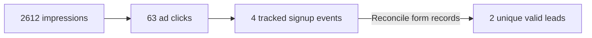

# Practical Guitar Theory — Project case study

**Period:** April–September 2026  
**Role:** Independent project owner  
**Experiment:** 12–18 June 2026, Google Search, United States, desktop traffic  
**Outcome:** Original broad offer rejected, medium confidence (decision recorded 3 July 2026)

## 1. Opportunity and research methodology

The hypothesis was that self-taught beginner-to-early-intermediate guitarists would be interested in a structured practical theory course that connects what they play to the underlying notes, chords, scales, keys and fretboard. The project was designed to test interest before committing to course production.

I used a staged niche-discovery process: founder/category fit, market mapping, keyword discovery, audience pain research, offer definition and a final niche-fit decision gate. Google Keyword Planner discovery was divided into five passes: beginner guitar theory, fretboard understanding, chords/progressions, scales/application and understanding what you play.

I filtered duplicate and irrelevant keywords, generic lookup terms, charts/tabs, other instruments and unsuitable search intent. The final conservative keyword set produced the following estimated monthly search volume (MSV):

| Selected proof cluster | Estimated MSV | Interpretation |
| --- | ---: | --- |
| Core practical guitar theory | 5,700 | Primary demand signal |
| Fretboard understanding | 1,100 | Supporting problem/module |
| Chords/progressions application | 1,200 | Supporting application angle |
| Scales/application support | 1,100 | Supporting module |
| **Total conservative niche-fit cluster** | **9,100** | Passed initial research screen |

The final worksheet records an average high-range CPC estimate of CHF 2.72. The search volumes were planning estimates, not actual visits, confirmed buyers or an estimate of sales. The 1,000–15,000 MSV screening range was a project-specific heuristic, not a universal market-validation standard.

Desk research across Reddit discussions, YouTube comments and paid course reviews revealed recurring problems: fragmented learning, memorising shapes without understanding them, difficulty navigating the fretboard, and translating scale patterns into music. This helped define the proposed learning roadmap and value proposition. These sources were qualitative desk research, not direct customer interviews.

The research justified a limited landing-page test, not a commitment to build the course.

## 2. Digital implementation

I created the customer-facing page with WordPress and Elementor Pro and configured the domain, hosting, DNS and HTTPS. The page described a practical guitar-first roadmap and invited prospective learners to join an early-access list. A successful form submission stored the lead, sent an administrator notification and redirected the visitor to a thank-you page.

### Measurement configuration

| Component | Implementation |
| --- | --- |
| WordPress integration | Site Kit installed GTM on the site |
| GTM | All-pages Google tag; thank-you page trigger with Page Path containing `/thank-you` |
| GA4 | `waitlist_signup` event, marked as a key event |
| Google Ads | GA4 signup key event imported as the primary conversion action |
| Quality check | Real form submission tested in GA4 Realtime; published GTM changes |
| Data verification | GA4 and Google Ads exports compared with Elementor submission records |

The thank-you page trigger measures a page visit, not a deduplicated database event. This is why recorded events must be reconciled with actual submissions. Consent Mode V2 was not fully implemented: the basic consent banner did not reliably control the GTM/GA4 tracking chain in reject/accept testing. This was a documented unresolved limitation of the learning test; it would need to be addressed before further live tracking.

I later preserved the website through backups and local WordPress restoration so that the implementation could be retained after the commercial experiment ended.

## 3. Controlled campaign

The paid-search campaign tested the early-access waitlist for the proposed course. No purchase or pre-order was offered or measured.

| Setting | Actual test |
| --- | --- |
| Dates | 12–18 June 2026 (seven days) |
| Market | United States, English |
| Channel | Google Search only; Display and Search Partners disabled |
| Devices | Desktop only |
| Keyword matching | Exact and phrase |
| Ad groups | Core Guitar Theory; Fretboard Understanding; Chords and Progressions |
| Bidding | Maximize Clicks, CHF 2.50 maximum CPC |
| Planned budget | Approximately CHF 100 |
| Primary action | Successful early-access waitlist signup |

I kept the page, offer, tracking, bidding and budget stable during the campaign. The documented adjustments were exact negative-keyword additions on days 1 and 2 to reduce obvious irrelevant traffic.

## 4. Results and reconciliation

| Metric | Result |
| --- | ---: |
| Impressions | 2,612 |
| Ad clicks | 63 |
| Spend | CHF 95.38 |
| Click-through rate | 2.41% |
| Average CPC | CHF 1.51 |
| Google Ads / GA4 signup events | 4 |
| Unique valid paid-acquisition leads | 2 |
| Clean click-to-lead conversion rate | 3.17% |
| Cost per unique valid lead | CHF 47.69 |

The form records contained five submissions, including one founder test. Four submissions related to paid traffic, matching the four tracked events. After removing a corrected misspelled entry and a repeat submission, two unique usable prospects remained. Here, paid-acquisition leads means leads acquired through paid advertising, not paying customers.

The four reported events suggested a 6.35% click-to-event rate. The clean lead rate was only 3.17%. Using the unadjusted conversion count would have understated the cost of acquiring a distinct prospect.

### Traffic quality

Google disclosed search terms for 32 of the 63 clicks. I classified these disclosed clicks into five intent buckets:

| Search-intent bucket | Disclosed clicks |
| --- | ---: |
| Core learning intent | 3 |
| Supporting learning intent | 7 |
| Pain/problem | 2 |
| Lookup-only | 14 |
| Wrong-market | 6 |
| **Total disclosed** | **32** |

Twenty of the 32 disclosed clicks were lookup-only or outside the intended market. The other 31 clicks, including the queries associated with all four tracked signup events, were not disclosed. Consequently, the visible query mix suggested weak traffic alignment but could not establish the precise intent of converting visitors.

The Fretboard Understanding ad group had the highest observed CTR (2.80%) and lowest average CPC (CHF 1.47) among the three groups. This was a directional research lead, not sufficient evidence of a winning niche.

## 5. Commercial evaluation

The commercial model used an assumed course price of CHF 99, assumed variable cost of CHF 10, and a resulting break-even customer acquisition cost (CAC) of CHF 89. No sales occurred; the lead-to-sale rates below are hypothetical scenarios.

The calculations were:

- Clean click-to-lead rate = 2 / 63 = 3.17%.
- Cost per valid lead = CHF 95.38 / 2 = CHF 47.69.
- Estimated CAC = cost per valid lead / assumed lead-to-sale rate.
- Break-even CAC = assumed price − assumed variable cost = CHF 89.

| Assumed lead-to-sale rate | Estimated CAC | Above break-even by |
| ---: | ---: | ---: |
| 10% | CHF 476.90 | CHF 387.90 |
| 20% (base case) | CHF 238.45 | CHF 149.45 |
| 25% | CHF 190.76 | CHF 101.76 |
| 30% | CHF 158.97 | CHF 69.97 |

At the 20% base assumption, the break-even cost per lead was CHF 17.80, considerably below the observed CHF 47.69. Even the 30% scenario exceeded the modelled break-even CAC. The project therefore did not justify producing the original broad course under those assumptions.

## 6. Decision, limitations and lessons

On 3 July 2026 the validation was closed as **FAIL, medium confidence**. I rejected the current broad offer and did not approve a direct repeat at a larger budget. A narrower fretboard-specific concept remained a separate hypothesis requiring fresh research and screening.

The result is directional: the sample was small, nearly half of clicked search queries were hidden, the campaign was desktop-only in one market, the waitlist did not measure willingness to pay, and the test did not isolate individual landing-page elements through A/B testing. Consent handling was also incomplete. The evidence was adequate for the project's resource-allocation decision, not a general verdict on guitar education or an estimate of long-run acquisition performance.

The most important improvements identified for a future experiment were tighter alignment between keyword intent and the page promise, stronger lookup-query exclusions, a meaningful commitment signal, deduplicated lead measurement, complete consent handling and predefined economic limits.

## 7. Evidence and scope

This case study summarizes the original project records rather than reproducing private files. Principal records used:

- `Research_final_summary.docx` and `Phase_7_Final_Doc3_Decision_Gate_Summary.docx` — niche discovery and research decision.
- `Niche_Fit_Final_GKP_Pass_Cleaned_Analysis.xlsx` — conservative keyword-cluster totals.
- `Phase_3_Status_Report.docx` and `Practical Guitar Theory - Google Ads Campaign Config - Updated.docx` — implementation and campaign configuration.
- `Phase_5_Monitoring_Report.pdf` and daily monitoring records — campaign stability and adjustments.
- June 2026 aggregate campaign, ad-group, conversion-action and GA4 exports — observed metrics.
- `Final Analysis Report.docx` and `Section 10 closeout report.pdf` — reconciled leads, assumptions, final verdict and learning log.

The individual lead records and raw exports are not published. The reconciliation is documented in the final report; underlying individual submissions are not independently reproduced here. All figures refer to the historical test rather than current campaign or website performance.
