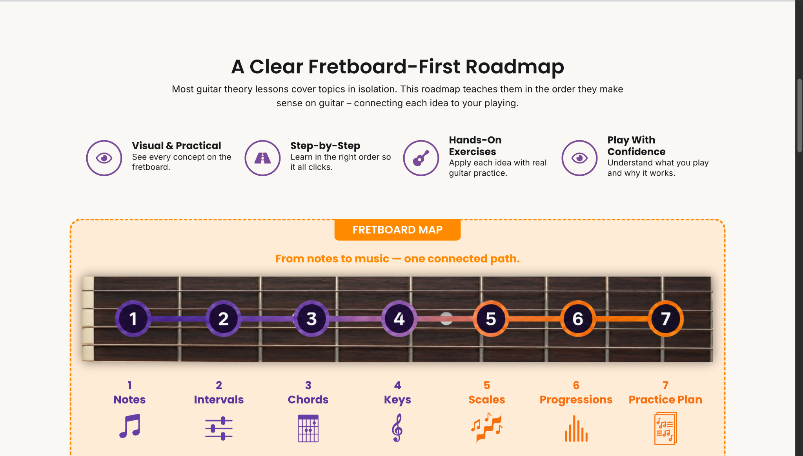
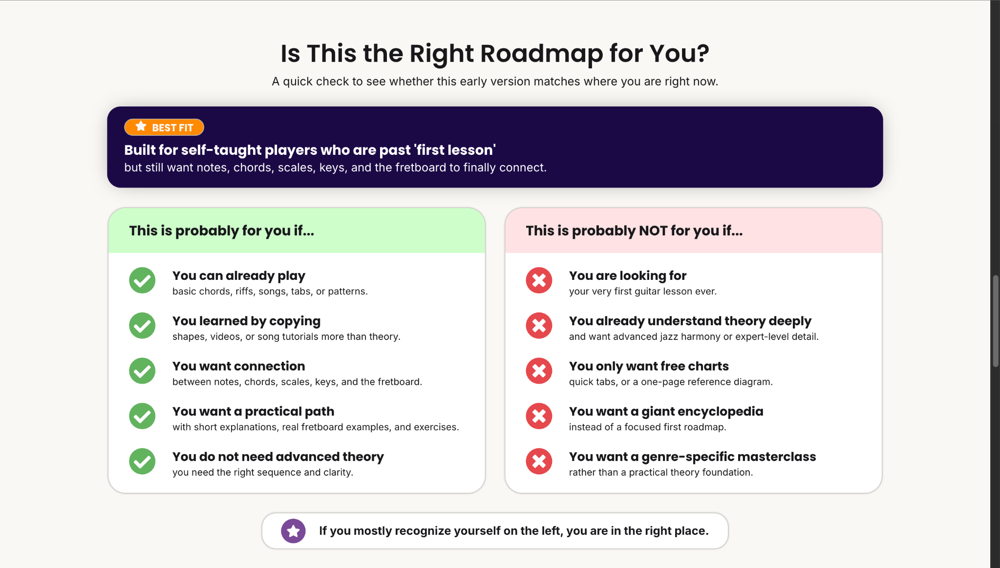
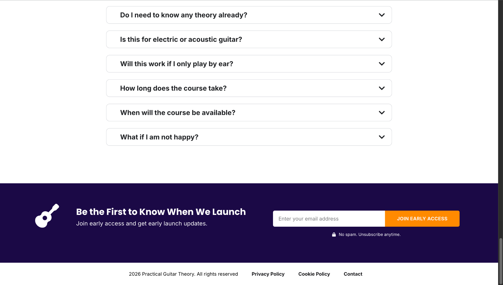
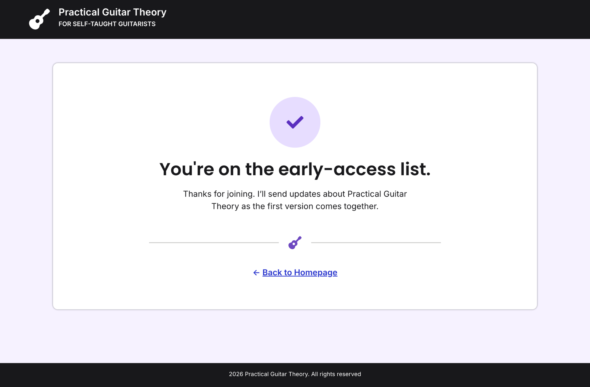
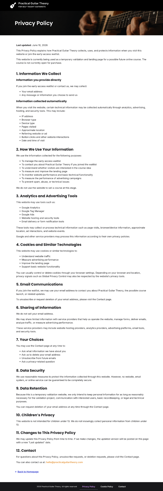
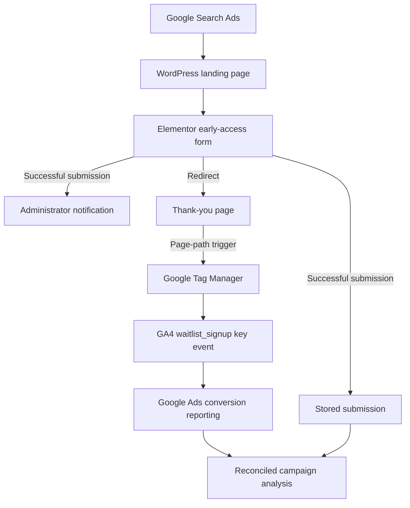

# Practical Guitar Theory

An independent product-validation project testing whether a structured, practical guitar-theory course for self-taught players could attract meaningful commercial demand.

**Project period:** April–September 2026  
**Status:** Validation completed; original broad offer not pursued  
**Stack:** WordPress · Elementor Pro · Google Tag Manager · Google Analytics 4 · Google Ads · Google Keyword Planner

## Project overview

Self-taught guitarists often learn songs, riffs, and shapes without understanding how notes, chords, scales, keys, and the fretboard connect. This project explored a course concept designed to solve that problem through a clear, guitar-first learning roadmap.

Instead of building the full course immediately, I tested the opportunity end-to-end: market research, positioning, landing-page creation, lead capture, tracking, paid acquisition, and post-campaign analysis.

## What I implemented

| Area | Implementation |
| --- | --- |
| Market discovery | Keyword clustering, search-intent filtering, audience pain research, and competitor review |
| Website | WordPress + Elementor Pro landing page, responsive layout, FAQ, trust/legal pages, contact page, and thank-you flow |
| Lead capture | Early-access signup form, stored form submissions, admin notifications, and redirect to thank-you page |
| Infrastructure | Domain and hosting setup, DNS, HTTPS, backup and local restoration |
| Measurement | GTM-based event setup, GA4 key event `waitlist_signup`, and Google Ads conversion import |
| Analysis | Reconciled tracked events with real submissions and evaluated acquisition economics |

## Visual walkthrough

### Hero section and value proposition

  

The landing page positioned the offer around a practical learning outcome: helping self-taught guitarists connect the pieces of music theory directly on the guitar.

### Core page sections

| Roadmap section | Audience fit section |
| --- | --- |
|  |  |
| The page translated the offer into a step-by-step fretboard-first roadmap. | The messaging also qualified who the offer was for — and who it was not for. |

| Mid-page explanation and signup section | FAQ and final CTA section |
| --- | --- |
|  |  |
| A secondary signup block reinforced the waitlist call-to-action after the roadmap explanation. | The bottom of the page addressed common objections and repeated the email capture CTA. |

### Supporting pages and post-submission flow

| Thank-you page | Contact page |
| --- | --- |
|  |  |
| Successful form submissions redirected to a confirmation page used in the measurement workflow. | A dedicated contact page allowed unsubscribe or support-related communication. |

| Privacy policy | Cookie policy |
| --- | --- |
|  |  |
| A dedicated privacy policy page documented data handling and communication use. | A cookie policy page documented cookie and measurement tooling usage. |

[View the detailed FAQ section](screenshots/faq-section.png).

### Full-page reference

  

## Technical workflow

The conversion event was triggered from the thank-you page path rather than a server-side form event, so tracked conversions were later reconciled against actual form submissions.

## Validation outcome

The seven-day experiment (12–18 June 2026) targeted desktop Google Search traffic in the United States.

| Metric | Result |
| --- | ---: |
| Impressions | 2,612 |
| Ad clicks | 63 |
| Spend | CHF 95.38 |
| Recorded signup events | 4 |
| Unique valid paid-acquisition leads | 2 |
| Clean click-to-lead conversion rate | 3.17% |
| Cost per unique valid lead | CHF 47.69 |

Although the campaign generated interest, the projected customer acquisition cost remained above the modelled break-even threshold across all tested lead-to-sale scenarios. Based on that result, I decided not to pursue the original broad offer in its tested form.

## What I learned

- A technically working funnel is not the same thing as a commercially validated offer.
- Keyword intent quality matters more than raw traffic volume.
- Conversion counts should be reconciled with real lead records before using them for economics.
- Demand validation becomes much more useful when paired with explicit break-even assumptions.
- AI can accelerate research, planning, implementation support, and analysis, but sound decision-making still depends on careful interpretation.

## Detailed case study

For the full research and commercial analysis, see **[CASE_STUDY.md](CASE_STUDY.md)**.

## Repository scope

This repository is a documentation-based portfolio of a WordPress/Elementor project, not a source-code distribution or a launched course. It does not include website databases, plugins, credentials, private analytics exports, or individual prospect records.
